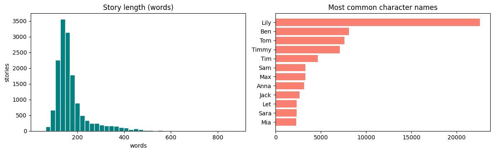
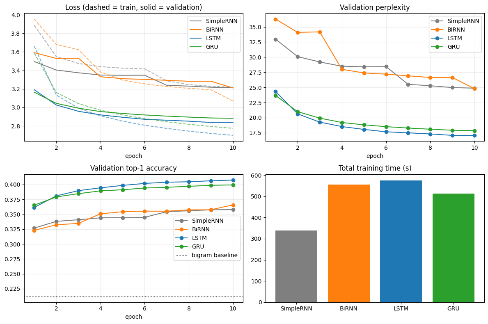
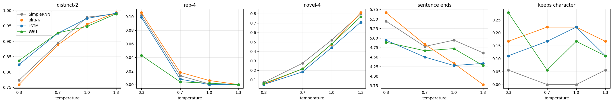

# Next-Word Story Generation on TinyStories

Comparing Simple RNN, Bidirectional RNN, LSTM and GRU for autoregressive word generation.

> Foundations of Generative AI (ICT4403), Assignment 2
> K Liya, Reg. No. 230953118, Section F

---

## 1. Problem statement and objective

An autoregressive language model writes text one word at a time. At each step it predicts the next word from the words before it, and that prediction becomes part of the input for the following step. The aim of this project is to build such a system for short children's stories and find out which recurrent architecture works best for it.

Objectives:
- clean the text and convert it into (context, next word) training pairs
- implement and train a **Simple RNN**, a **Bidirectional RNN**, an **LSTM** and a **GRU** under identical conditions
- evaluate them with loss, perplexity, top-1/top-5 accuracy and training time, and judge the generated text for coherence, diversity, contextual consistency and repetition
- generate from the same prompts at four temperatures (0.3, 0.7, 1.0, 1.3), analyse the effect of temperature and choose the best model

## 2. Dataset

**TinyStories** (Eldan and Li, 2023): about 2.1 million short stories written in simple English, using only words a typical 3 to 4 year old would understand. The dataset was created specifically for training and studying small language models.

- Dataset link (Hugging Face): https://huggingface.co/datasets/roneneldan/TinyStories
- Paper: *TinyStories: How Small Can Language Models Be and Still Speak Coherent English?*, https://arxiv.org/abs/2305.07759

**Subset used.** Training four models on 2.1 million stories isn't practical on one GPU, so the notebook streams:
- the first **15,000 stories** of the official training split, for training
- the first **3,000 stories** of the official validation split. The first 1,500 are used as the validation set (early stopping and choosing the best epoch) and the other 1,500 as the test set (final results only).

**Characteristics (15,000 training stories)**

| Property | Value |
|---|---|
| Words | 2,617,830 |
| Distinct words | 10,937 (2,551 used only once) |
| Story length | 43 to 878 words, median 152 |
| Stories starting with *"Once upon a time"* | 9,131 (61%) |
| Most common names | Lily (22,584), Ben (8,091), Tom (7,628), Timmy (7,095) |

The stories are short and follow very similar patterns: a character is introduced, something small happens (a lost toy, a trip to the park, a new friend) and there is a simple ending or moral. There is a lot of short dialogue. The small vocabulary and the repeated structure make the next word much more predictable than in news or Wikipedia text, but each story still has characters and a plot to keep track of.



(The name chart also shows *Let*, because the simple capital-letter check counts *"Let's"* at the start of a sentence.)

### Preprocessing
1. Convert curly quotes and apostrophes to plain ones.
2. Lowercase, replace hyphens and underscores with spaces, keep words (with apostrophes, so `didn't` and `lily's` stay whole) and `. , ! ?` as separate tokens. Quote marks are dropped.
3. Build the vocabulary from the training stories only, keeping words that appear at least 5 times. Everything else becomes `<unk>`.

Result: 3,032,409 training tokens, a vocabulary of 6,147, and only 0.28% of tokens mapped to `<unk>`.

### Building the sequences
- Context length 16. For every position in a story, the previous 16 tokens are the input and the next token is the target (sliding window, stride 1).
- Windows never cross from one story into the next. The first 16 tokens of each story are only used as context.

| Split | Input-target pairs |
|---|---|
| Train | 2,792,409 |
| Validation | 236,840 |
| Test | 272,849 |

```
girl named lily found a needle in her room . she knew it was difficult to   =>  play
```

## 3. Models implemented

**Simple RNN.** The most basic recurrent network. It reads the 16 context tokens one by one, and at each step a single tanh layer combines the current word embedding with the previous hidden state. The hidden state works as a running summary of the story so far, and after the last token it is passed to the output layer, which scores every word in the vocabulary. It's fast and small, but gradients shrink as they are passed back through the steps (the vanishing gradient problem). As a result it relies mostly on the last few words, which makes it the natural baseline here.

**Bidirectional RNN.** Two simple RNNs over the same context window, one reading it left to right and the other right to left. Their final states are joined into a 1,024-value vector, so the output layer sees the window summarised from both ends. The backward RNN only reads the context, never the word being predicted, so the model can still generate text left to right. It costs roughly twice the recurrent computation and has a larger output layer. For next-word prediction the backward pass adds little, because the most useful words are the ones just before the target, which the forward pass already covers.

**LSTM (Long Short-Term Memory).** Designed to fix the vanishing gradient problem. Besides the hidden state it keeps a separate cell state that acts like a memory line through the sequence, controlled by three gates. The input gate decides what to write to memory, the forget gate what to erase, and the output gate how much of the memory to expose at each step. Because the cell state only changes through these small gated updates, information (and gradients) can travel across many steps. In a story, this helps with things like which character is acting and what they are doing. It has four gate blocks, so it has the most recurrent parameters of the one-directional models and is the slowest per step.

**GRU (Gated Recurrent Unit).** A lighter gated cell with two gates and no separate cell state. The update gate decides how much of the previous hidden state to keep and how much to replace, and the reset gate decides how much of the past to use when computing the new information. With three gate blocks instead of four, it has fewer parameters than the LSTM and usually trains a bit faster, while handling longer dependencies almost as well. It is the most direct comparison point for the LSTM.

### Architecture

Common structure: `Embedding(6147, 200) -> Dropout(0.25) -> recurrent layer (512 units) -> Dropout(0.25) -> Linear(6147)`

| Model | Recurrent part | Used for prediction | Parameters |
|---|---|---|---|
| Simple RNN | `nn.RNN` (tanh) | final hidden state | 4,748,379 |
| Bidirectional RNN | forward + backward `nn.RNN` | both final states joined | 8,261,211 |
| LSTM | `nn.LSTM` | final hidden state | 5,845,083 |
| GRU | `nn.GRU` | final hidden state | 5,479,515 |

**Identical training settings:**
- Adam (lr 0.001), batch size 512, cross-entropy loss, gradient clipping at 1.0, mixed precision on the GPU
- the learning rate is halved after any epoch in which validation loss doesn't improve
- a maximum of 10 epochs, with early stopping if validation loss doesn't improve for 2 epochs in a row
- the weights from the epoch with the lowest validation loss are restored, and the same seed (2024) is used for every model

## 4. Running the code

### Kaggle
1. Kaggle > Create > New Notebook > File > Import Notebook > upload `notebook/tinystories_textgen_rnn_lstm_gru.ipynb`
2. Settings (right panel): **Internet = On** (the stories are streamed from Hugging Face with the `datasets` library) and **Accelerator = GPU**.
3. *Run All* (or *Save Version > Save & Run All*). On a T4 the four models trained for 33 minutes in total, and the whole notebook ran in about 34 minutes. Outputs are saved to `/kaggle/working`.

### Local machine (a CUDA GPU is strongly recommended)
```bash
git clone https://github.com/<your-username>/tinystories-next-word-generation.git
cd tinystories-next-word-generation
pip install -r requirements.txt
jupyter notebook notebook/tinystories_textgen_rnn_lstm_gru.ipynb
```
When not on Kaggle the outputs go to a `results/` folder next to the notebook.

### Requirements
Python 3.10 or newer, `torch`, `datasets`, `numpy`, `pandas`, `matplotlib`, `tabulate`, `jupyter`. See `requirements.txt`.

### Files
```
tinystories-next-word-generation/
├── README.md
├── requirements.txt
├── notebook/
│   └── tinystories_textgen_rnn_lstm_gru.ipynb   # executed notebook with outputs and analysis
├── results/
│   ├── model_metrics.csv                        # loss, perplexity, accuracy and time per model
│   ├── temperature_analysis.csv                 # generation metrics per model and temperature
│   ├── results_summary.md                       # summary of the run
│   ├── dataset_overview.png
│   ├── training_comparison.png
│   └── temperature_effects.png
└── samples/
    └── generated_text_samples.txt               # generated stories for every model, prompt and temperature
```

## 5. Results

Results from the Kaggle run (Tesla T4), using each model's best checkpoint. The test stories were never used for training or for choosing epochs.

| Model | Epochs trained of 10 (best epoch) | Train PPL | Val PPL | Test loss | **Test PPL** | Train acc | Val acc | **Test top-1 acc** | **Test top-5 acc** | Time / epoch | Total time |
|---|---|---|---|---|---|---|---|---|---|---|---|
| Simple RNN | 10 (10) | 18.4 | 24.9 | 3.180 | 24.1 | 37.6% | 35.8% | 36.3% | 62.5% | 33.8 s | 338 s |
| BiRNN | 10 (10) | 14.4 | 24.8 | 3.179 | 24.0 | 40.0% | 36.6% | 37.1% | 63.5% | 55.5 s | 555 s |
| **LSTM** | 10 (9) | 10.9 | **17.1** | **2.805** | **16.5** | 44.7% | **40.6%** | **41.3%** | **68.3%** | 57.6 s | 576 s |
| GRU | 10 (10) | 10.9 | 17.9 | 2.846 | 17.2 | 44.4% | 39.9% | 40.7% | 67.7% | 51.2 s | 512 s |

Train PPL and train accuracy are measured in evaluation mode (no dropout) on a random sample of 200,000 training windows. No model triggered early stopping, so all four trained for the full 10 epochs.

**Baselines on the same test positions:**

| Predictor | Test top-1 accuracy |
|---|---|
| Always predict the most common token (`.`) | 8.3% |
| Bigram lookup (most frequent follower of the previous token) | 21.3% |
| Best model (LSTM) | **41.3%** |

Total training time for all four models: 33 minutes.



## 6. Model comparison and evaluation

**Quantitative**
- **The LSTM is the best model on every test metric**: perplexity 16.5, top-1 accuracy 41.3% and top-5 accuracy 68.3%. It guesses the exact next word about 4 times in 10 on stories it has never seen, and the right word is in its top 5 more than two thirds of the time. The **GRU** is close behind (17.2, 40.7%, 67.7%).
- **The gated models are clearly better than the plain RNNs.** Their test perplexity is 28 to 31% lower and their accuracy 3.5 to 5 points higher. Stories need the model to keep track of who is doing what, and the gates carry that information through the window.
- **Every model beats both baselines by a wide margin.** The LSTM is 20 points above the bigram lookup and 5 times better than always guessing a full stop.
- **The BiRNN is no better than the Simple RNN** (perplexity 24.0 vs 24.1, accuracy 37.1% vs 36.3%), despite 74% more parameters and 64% more time per epoch. It also has the largest gap between training and test perplexity (14.4 vs 24.0), so the extra capacity mostly goes into fitting the training stories.
- **Overfitting is mild overall.** With about 2.8 million training windows, test perplexity is only 1.3 to 1.7 times the training perplexity for all four models.
- **Training budget.** All four used the full 10 epochs. The LSTM's best epoch was 9 (epoch 10 gave the same validation loss), and the other three were still improving at epoch 10.
- **Learning-rate halving shows up in the curves.** The drops in validation loss at epoch 7 (Simple RNN) and epochs 4 and 10 (BiRNN) come right after an epoch without improvement, when the learning rate was halved. The LSTM and GRU improved steadily and have smooth curves.
- **Speed.** Simple RNN 34 s per epoch, GRU 51 s, BiRNN 56 s, LSTM 58 s.

**Qualitative** (same prompts for all models)

Text quality was measured on 18 samples of 50 words per model and temperature (3 prompts, 6 samples each) using:
- **TTR / distinct-2**: unique words or bigrams over total (diversity)
- **rep-4**: share of 4-grams that repeat inside one sample (repetition)
- **novel-4**: share of generated 4-grams that never appear in the training stories (low means copying, very high usually means word salad)
- **sentence ends**: full stops, `!` and `?` per 50 words (whether it forms sentences)
- **keeps character**: share of samples that mention the prompt's main character again (Lily, Tom, the dog), a simple check of contextual consistency

| | Simple RNN | BiRNN | LSTM | GRU |
|---|---|---|---|---|
| Coherence (T=0.7) | loops on short dialogue lines | grammatical, but sentences don't connect | the most story-like scenes | story-like scenes, close to the LSTM |
| Diversity (distinct-2, T=0.7) | 0.893 | 0.888 | 0.926 | **0.927** |
| Repetition (rep-4, T=0.7) | 0.013 | 0.018 | 0.008 | **0.004** |
| Contextual consistency | keeps the type of story, rarely keeps the character | switches characters quickly (Tom becomes Lily) | keeps the scene for a few sentences, then new names appear | keeps the scene for a few sentences, then new names appear |
| Contextual consistency proxy: keeps character (T=0.7) | 0.000 | **0.222** | 0.167 | 0.056 |

Example, prompt *"Once upon a time, there was a little girl named Lily. She"*, T = 0.7:
- **LSTM:** *"Loved to play outside with her friends. One day, lily found a big box on the ground. She wanted to know what it was, so she asked her mom for help."*
- **Simple RNN:** *"Saw her small toy car and said, hi, mr. Brown, please. I love you, mom. I am sorry. I am sorry. I am sorry."*

All four models keep the *style* of a TinyStories story very well (simple sentences, a small problem, mom and dad, a feeling). The main weakness is contextual consistency. A 16-token window is only one or two sentences, so once the character's name scrolls out of the window the model forgets it, and new names appear (*"But sara said they could play with it. Tim said..."*, LSTM). The keeps-character score is based on only 18 samples per setting, so it's noisy and should be read alongside the samples.

## 7. Sampling temperature analysis

Prompts: *"Once upon a time, there was a little girl named Lily. She"*, *"One day, Tom went to the park with his mom and"*, *"The little dog was very sad because"*.

| Model | T | TTR | distinct-2 | rep-4 | novel-4 | sentence ends | keeps character |
|---|---|---|---|---|---|---|---|
| SimpleRNN | 0.3 | 0.571 | 0.773 | 0.102 | 0.072 | 5.44 | 0.056 |
| | 0.7 | 0.634 | 0.893 | 0.013 | 0.275 | 4.78 | 0.000 |
| | 1.0 | 0.748 | 0.978 | 0.001 | 0.520 | 4.94 | 0.000 |
| | 1.3 | 0.812 | 0.989 | 0.000 | 0.797 | 4.61 | 0.056 |
| BiRNN | 0.3 | 0.550 | 0.759 | 0.106 | 0.052 | 5.67 | 0.167 |
| | 0.7 | 0.641 | 0.888 | 0.018 | 0.216 | 4.83 | 0.222 |
| | 1.0 | 0.706 | 0.955 | 0.006 | 0.476 | 4.33 | 0.222 |
| | 1.3 | 0.804 | 0.993 | 0.000 | 0.811 | 3.78 | 0.167 |
| LSTM | 0.3 | 0.600 | 0.824 | 0.099 | 0.050 | 4.94 | 0.111 |
| | 0.7 | 0.668 | 0.926 | 0.008 | 0.184 | 4.50 | 0.167 |
| | 1.0 | 0.750 | 0.974 | 0.000 | 0.441 | 4.28 | 0.222 |
| | 1.3 | 0.786 | 0.991 | 0.000 | 0.710 | 4.33 | 0.111 |
| GRU | 0.3 | 0.587 | 0.837 | 0.043 | 0.061 | 4.89 | 0.278 |
| | 0.7 | 0.666 | 0.927 | 0.004 | 0.216 | 4.67 | 0.056 |
| | 1.0 | 0.692 | 0.948 | 0.002 | 0.478 | 4.72 | 0.167 |
| | 1.3 | 0.800 | 0.989 | 0.000 | 0.767 | 4.28 | 0.111 |



**T = 0.3 (low).** Safe but loopy. Three of the models repeat about 10% of their 4-grams within 50 words, and only 5 to 7% of 4-grams are new, so the text is mostly stitched-together training phrases:
> BiRNN: *"It was a big, red ball. It was a big, shiny rock. It was a big, shiny rock."*

The GRU is the exception, with much less repetition (0.043) and sensible text: *"He lost his ball. He wanted to play with the ball, but he didn't know what to do."*

**T = 0.7 (medium).** The best balance. Repetition almost disappears (rep-4 0.004 to 0.018), about 20% of 4-grams are new, and the sentences still form small scenes:
> LSTM: *"They saw a big slide and wanted to play with it. They asked their mom if they could go and see the penguins."*

**T = 1.0.** About half of the 4-grams are new. Some samples are still good (*"She looked everywhere, but she couldn't find it. She began to cry, but then she remembered her mom's warning."*, GRU), while others combine things that don't fit (*"Max was so happy he could move to the soft water on her hand"*, LSTM).

**T = 1.3 (high).** Word salad. 71 to 81% of 4-grams are new, and sentences turn into long run-ons, so the number of sentence endings drops (BiRNN 3.8 per 50 words vs 5.7 at T = 0.3):
> GRU: *"Mama brought peter make mama with those resist of them because parent were a yummy leak."*

Raising the temperature increases diversity and removes repetition, but coherence falls apart. Lowering it gives fluent text that repeats itself and copies training phrases. The keeps-character score doesn't follow a clear trend with temperature, because character tracking is limited mainly by the 16-token window rather than by sampling. **T around 0.7** gives the best mix of fluent, varied and non-repetitive stories for this dataset.

All generated samples are in [`samples/generated_text_samples.txt`](samples/generated_text_samples.txt).

## 8. Conclusion

The **LSTM** is the most effective model for autoregressive story generation on TinyStories:

1. the best held-out numbers of the four: test loss 2.805, perplexity 16.5, top-1 accuracy 41.3% and top-5 accuracy 68.3%, compared with 21.3% for the bigram baseline
2. the most coherent stories at T = 0.7, with low repetition (rep-4 0.008) and high diversity (distinct-2 0.926)
3. its validation loss only levelled off at the very end (best epoch 9), so it made full use of the 10-epoch budget

The GRU is a close second (perplexity 17.2, 40.7%), about 11% faster per epoch and the least repetitive at low temperatures, so it is a good choice when training time matters. The Simple RNN is the fastest but clearly weaker. The Bidirectional RNN is the least suitable: it has the most parameters and the slowest training after the LSTM, but it only matches the Simple RNN, because reading the context backwards doesn't help predict the next word. **Recommended setup: LSTM with a sampling temperature of about 0.7.**
